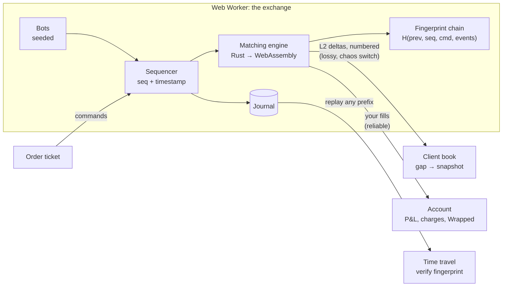

# Arena

**A stock exchange you can play, replay and audit, in your browser.**

Trade index futures against a market of bots. Watch your order wait in the queue, pay the spread and real Indian charges, then rewind the whole exchange and verify every order.

| | |
|---|---|
| **Live** | https://vikaspal1704.github.io/arena/ |
| **Engine** | Rust, no dependencies, compiled to a WebAssembly module under 90 KB (81–82 KB with the Rust versions tested; the exact size depends on the compiler) with no JavaScript glue |
| **Speed** | 2.4–3.7 M commands/s, p50 ≈ 220–320 ns, p99 ≈ 0.9–1.3 µs (native, one core, empty starting book, shared VM); 1.4–1.9 M commands/s on a book of 1 million orders; 2.1–2.5 M commands/s as WebAssembly in Node and Chromium. Cancels hit live orders (0% rejected, checked by the benchmark). Timings vary by host (another VM of the same class measured 20–35% lower); machine, method and full numbers: [benchmarks](docs/BENCHMARKS.md) |
| **Correctness** | Differential-tested against a separately written Python engine on 1.5 million random commands in CI (the reference is the author's earlier project, so it checks the implementation, not the reading of the rules); property tests and invariant checks on top |
| **Stack** | Rust · WebAssembly · TypeScript · React · Web Workers · Vite · Vitest · Playwright |
| **License** | [MIT](LICENSE) |

Built by **Vikas Pal** (Software Engineer, Fintech). Arena brings together three earlier projects: [mini-matching-engine](https://github.com/vikaspal1704/mini-matching-engine) (the matching rules, now the reference implementation), [live-orderbook-feed](https://github.com/vikaspal1704/live-orderbook-feed) (the market-data protocol) and [F&O Wrapped](https://github.com/vikaspal1704/fo-wrapped) (post-trade analytics and the Indian charges table).

---

## Try it in 60 seconds

1. Open the [live demo](https://vikaspal1704.github.io/arena/) and press **Start the lessons**. Seven hands-on lessons (take liquidity, make liquidity, cancel, close a round trip, break the feed, audit the exchange, read your Wrapped) each end with an explanation in your own numbers, and a coach note explains every fill. The **?** buttons explain the jargon.
2. Buy one lot at market. You pay the spread, and the **Position** panel shows what the charges already cost you.
3. Click a price in the book to place a limit order, then watch **Your orders** count down the queue ahead of you.
4. Under the hood, drag **Chaos** to 30%: packets are dropped, the client detects the gaps and heals from snapshots.
5. Press **Pause and time-travel** and drag the slider. The exchange is rebuilt from its journal at that point, and the fingerprint is checked against the one recorded live.
6. Press **Run 1M commands** to benchmark the engine in your own browser.
7. **End session** for your session, Wrapped: net P&L after charges, win rate, how your fills compared with the hidden fair value, and a replay of the whole session checked against the fingerprints recorded live.

`?seed=123` replays the same market: the bots make exactly the same moves until you trade differently.

**Real-market mode (local).** With your own Kite Connect app, a small bridge on your machine streams live NIFTY futures prices and the real 5-level book into Arena; the bots quote around the real price. Your secret stays on your machine and your orders stay simulated. Setup: [`docs/REAL_MARKET.md`](docs/REAL_MARKET.md).

**Options bot (local).** On the same Kite session, `bot/` trades NIFTY and SENSEX options with written rules: opening-range breakouts in the direction of the trend, an exchange stop from the first second, breakeven and trailing stops, and account limits (₹800 risk a trade, ₹1,200 a day, two losses and it stops). It paper trades on live prices by default. Real orders stay locked until there is a profitable paper record, a config acknowledgement and a typed confirmation. Every decision is logged with the rule that made it, and recorded days replay exactly. Rules, limits and the honest maths of a ₹10,000 account: [`docs/TRADING_BOT.md`](docs/TRADING_BOT.md).

---

## How it works



- **Matching engine** (`crates/engine`): price-time priority, limit / market (IOC) / cancel, integer prices, lazy cancels (a cancelled order becomes a tombstone that matching skips, so a cancel costs O(log n), not a queue scan). No floats, clocks or hash-map iteration anywhere, so results are byte-for-byte reproducible.
- **Sequencer and journal** (`exchange.rs`): every command gets a sequence number and is journalled before it is applied. State is a pure function of the journal, and a chained fingerprint after each command lets anyone verify a replay at every step. The chain uses FNV-1a, so it detects **accidental divergence** (a bug, a platform difference, a lost or changed command), **not tampering**: anyone who can edit a journal can recompute a matching chain.
- **Bots** (`sim.rs`): a market maker that skews its quotes against inventory, noise traders, and a momentum trader, all around a hidden fair value that drifts and occasionally jumps. They go through the sequencer like anyone else, so replaying needs no bot logic.
- **WebAssembly** (`crates/wasm`): plain exported functions; results are written to a buffer in module memory that TypeScript reads directly. Native and WebAssembly builds produce the same fingerprint (checked in CI).
- **Two channels**, like a real venue: market data is a numbered, lossy stream of deltas with gap detection and snapshot recovery; the player's own order events use a reliable private channel.
- **Session Wrapped** (`web/src/core/session.ts`): FIFO round trips, charges from F&O Wrapped's dated rate table, edge against fair value, personal "try this next" advice, and a comparison with your previous session.
- **A screen you can read while it moves**: the ladder has fixed slots so rows never jump, changed quantities flash briefly instead of moving, and boxes have fixed sizes. Over 6 s of live trading, cumulative layout shift measures 0.012–0.015 (three runs of `e2e_layout_stays_still_while_the_market_moves`, which prints it), and the test fails above 0.05.

Design decisions and trade-offs: [`docs/ARCHITECTURE.md`](docs/ARCHITECTURE.md). Visual design rules: [`docs/DESIGN.md`](docs/DESIGN.md).

---

## Proof, not claims

| Claim | How it is checked |
|-------|-------------------|
| The matching rules are right | `difftest/`: seeded random streams from three owners (limits, markets, cancels, cancels by the wrong owner, invalid input) run through this engine (default configuration) and [mini-matching-engine](https://github.com/vikaspal1704/mini-matching-engine); order ids, every trade with its owners, every rejection, remaining quantities and the whole book must match after **every** command. 300 seeds × 5,000 commands (1.5 million commands, 963,654 trades) in CI. Removing the engine's owner check is caught at command 743, and turning self-trade prevention on by default at command 2. |
| The book never goes wrong | `check_invariants` after every command in 400,000 random commands (with and without self-trade prevention): never crossed, no empty levels, level totals equal live orders, FIFO order kept. Property tests (`crates/engine/tests/properties.rs`, proptest) check the same from the public API on arbitrary configurations and command streams, plus conservation of traded quantity, exact replay of the journal, and no panic on any value of any field, including `u64`/`i64` extremes. |
| Replays are exact | Every prefix of a 3,000-step session replays to the recorded fingerprint; changing one command changes every later fingerprint. The browser checks this on demand. This is a consistency check against accidental divergence, not tamper evidence ([why](docs/ARCHITECTURE.md#35-the-fingerprint-chain)). |
| It is deterministic everywhere | Same seed → same fingerprint natively, in WebAssembly (Node), and in two separate browser pages (Playwright). |
| The feed heals | Under 20% packet loss, the client book rebuilt from deltas and snapshots ends identical to the engine's book. |
| Nothing leaves the browser | Playwright asserts zero third-party requests. The page's CSP (`web/index.html`) allows scripts, styles, workers and connections from its own origin only, plus WebSocket connections to `localhost` / `127.0.0.1` for the optional local Kite bridge; images may also be `data:` URLs and styles may be inline. |

Full list: [`docs/TEST_PLAN.md`](docs/TEST_PLAN.md).

**Check it yourself:** `scripts/verify-claims.sh` runs every engine claim above and prints PASS / FAIL for each (`--mutations` also breaks the engine on purpose to show the tests notice). Reading order, claim-to-code map and known weak spots: [`docs/REVIEWING.md`](docs/REVIEWING.md).

---

## Run it

```bash
# Engine: tests, benchmark, differential test
cargo test --release
cargo run --release -p arena-bench -- 2000000   # standard and deep-book scenarios
pip install git+https://github.com/vikaspal1704/mini-matching-engine
cargo build --release -p arena-difftest && python difftest/compare.py --seeds 1-20 --count 5000

# Web app (needs the wasm32 target: rustup target add wasm32-unknown-unknown)
cd web
npm ci
npm run dev        # builds the engine to WebAssembly, then starts Vite
npm test           # core tests against the real WebAssembly build
npm run build && npm run test:e2e
```

## Layout

```
crates/engine/     # matching engine, sequencer, journal, fingerprint, bots (no dependencies)
crates/wasm/       # WebAssembly exports (no wasm-bindgen)
crates/bench/      # throughput and latency percentiles
crates/difftest/   # emits a random command stream and this engine's results
bridge/            # local-only Kite Connect bridge for real-market mode (Node, one runtime dependency)
bot/               # NIFTY and SENSEX options bot: strategy, risk, paper and live brokers, replay
difftest/          # compares them with the Python reference engine
web/src/core/      # pure TypeScript: wasm wrapper, feed protocol, account, charges
web/src/worker/    # the exchange process and the benchmark worker
web/src/app/       # trading desk, under-the-hood panels, Wrapped
docs/              # PRD, architecture, test plan, benchmarks, roadmap, reviewer's guide
scripts/           # verify-claims.sh: checks every engine claim
```

## Known limits

- **Memory grows for the whole session:** the order archive (40 bytes per accepted order), the journal (40 bytes per command) and its fingerprints (8 bytes per command) are never trimmed, so that is up to about 88 MB per million commands.
- **Cancelled-order tombstones** stay in their level's queue until matching reaches them or the level empties. A level that never trades and always keeps one live order grows without bound.
- **Single instrument, single thread, no persistence.** Everything is in memory. The browser can download the journal, but it cannot load one back yet.
- **No self-trade prevention by default.** The default matches the reference engine. `SelfTradePrevention::CancelNewest` is available, but the differential test does not cover it.
- **The fingerprint detects accidental divergence, not tampering.**
- At most 2^32 units per order, and fewer than 2^32 orders at one price.

Details: [`docs/ARCHITECTURE.md`](docs/ARCHITECTURE.md#5-known-limits).

## What it is not

A simulated market with play money. Bots are simple by design; the fair value is a random walk, not a model of NIFTY. The options bot is a tool with written rules, not a promise of profit. Not investment advice.
